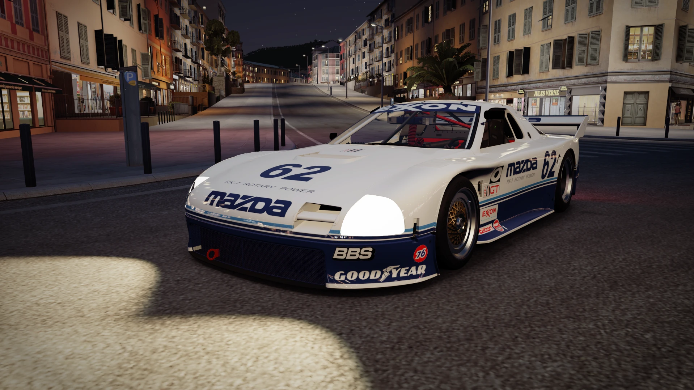
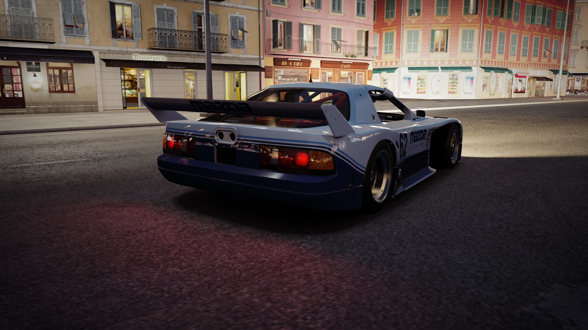

# Mazda RX-7 Mazda Motorsport #62 — 1991 IMSA GTO, Headlights Version (Forza Horizon 2 PC)

The **1991 Mazda RX-7 #62** IMSA GTO race car, ported from **Forza Motorsport 6** into **Forza Horizon 2** on PC as a brand new car (it does not replace any stock car).

> **This is the version with headlights.** The Forza Motorsport 6 car was built for day races and only has empty headlight covers. This version adds working headlights, so you can drive it at night.

*Version française plus bas : [Tutoriel en français](#-tutoriel-en-français).*

## Features

- **New car "RX-7 Mazda Motorsport n°62"** (car Id **19921**), sold at the **Autoshow** under **Mazda** for **650,000 CR**, in the **Hypercars** category, with its own Autoshow picture.
- **Full Forza Motorsport 6 car**: body, Mazda Motorsport livery, cockpit and roll cage, gold mesh racing wheels.
- **Its own physics and upgrades**, taken from the FM6 car.
- **Its own engine sound**: the FM6 recordings (engine, intake, exhaust) in their own sound bank, so no other car's sound is changed.
- **Taillights like in FM6**: lit at night, the whole lamp glows when braking.
- **Night headlights added**: the FM6 car only has the empty headlight covers (it was made for day races). Like the real car at night races, the covers now hold clear glass with a lamp behind it that lights up with the game's headlights and really lights the road.

## Requirements

- Forza Horizon 2 running on PC with **[Azimuth](https://almost-there-games.itch.io/azimuth)** 1.0.4.
- **[Extra Options](https://github.com/RokkuDayo/ForzaHorizon2_ExtraOptions)** 0.4.4 or newer (it loads the `mods` folder).

## Installation

1. **Close the game.**
2. Download `RX7_62_Mazda_Motorsport_v1.0.zip` from the [Releases](../../releases) page.
3. Extract it into the **`mods`** folder of your Azimuth folder (the `mods` folder next to `azimuth.exe`). You must end up with `mods\MAZ_62_RX7_91 Mazda Motorsport\mod.json`.
4. Launch the game and buy the car at the Autoshow (Mazda) for 650,000 CR.

Extra Options adds the new folder to `mods\loadorder.txt` automatically.

**Uninstall:** delete `mods\MAZ_62_RX7_91 Mazda Motorsport`.

## Notes

- **Sound bank:** the mod ships its own `MasterBank.strings.bank` (the game needs it to find the car's own engine sounds). Another mod that replaces the same file will conflict with this one.
- The headlights are an addition: they are not in the FM6 car.

Tested on Forza Horizon 2 + Azimuth 1.0.4 + Extra Options 0.4.4.

---

## 🇫🇷 Tutoriel en français

La **Mazda RX-7 n°62** IMSA GTO de 1991, portée depuis **Forza Motorsport 6** dans **Forza Horizon 2** sur PC, comme une nouvelle voiture (elle ne remplace aucune voiture du jeu).

> **C'est la version avec phares.** La voiture de Forza Motorsport 6 a été faite pour les courses de jour et n'a que des caches de phares vides. Cette version ajoute de vrais phares, pour pouvoir rouler de nuit.

### Ce qu'il y a dedans

- **Nouvelle voiture « RX-7 Mazda Motorsport n°62 »** (ID **19921**), en vente au **Salon auto**, chez **Mazda**, pour **650 000 CR**, dans la catégorie **Hypercars**, avec sa propre image au Salon auto.
- **La voiture complète de FM6** : carrosserie, livrée Mazda Motorsport, habitacle et arceau, jantes de course dorées.
- **Sa propre physique et ses propres améliorations**, reprises de FM6.
- **Son propre son moteur** : les enregistrements de FM6 (moteur, admission, échappement) dans leur propre banque de sons, donc aucune autre voiture n'est modifiée.
- **Feux arrière comme dans FM6** : allumés la nuit, tout le feu s'illumine au freinage.
- **Phares de nuit ajoutés** : la voiture de FM6 n'a que les caches de phares vides (elle était faite pour les courses de jour). Comme la vraie voiture en course de nuit, les caches ont maintenant un vrai verre avec un phare derrière, qui s'allume avec les phares du jeu et éclaire vraiment la route.

### Prérequis

- Forza Horizon 2 sur PC avec **[Azimuth](https://almost-there-games.itch.io/azimuth)** 1.0.4.
- **[Extra Options](https://github.com/RokkuDayo/ForzaHorizon2_ExtraOptions)** 0.4.4 ou plus récent (il charge le dossier `mods`).

### Installation

1. **Ferme le jeu.**
2. Télécharge `RX7_62_Mazda_Motorsport_v1.0.zip` sur la page [Releases](../../releases).
3. Extrais-le dans le dossier **`mods`** de ton dossier Azimuth (le dossier `mods` à côté de `azimuth.exe`). Tu dois obtenir `mods\MAZ_62_RX7_91 Mazda Motorsport\mod.json`.
4. Lance le jeu et achète la voiture au Salon auto (Mazda) pour 650 000 CR.

Extra Options ajoute tout seul le nouveau dossier dans `mods\loadorder.txt`.

**Désinstaller :** supprime `mods\MAZ_62_RX7_91 Mazda Motorsport`.

### Remarques

- **Banque de sons :** le mod contient son propre `MasterBank.strings.bank` (le jeu en a besoin pour trouver le son moteur de la voiture). Un autre mod qui remplace ce même fichier entrera en conflit avec celui-ci.
- Les phares sont un ajout : ils ne sont pas dans la voiture de FM6.

---

## Credits

- Car model and livery: **Forza Motorsport 6**, Turn 10 Studios / Microsoft.
- [Azimuth](https://almost-there-games.itch.io/azimuth) by Almost There Games.
- [Extra Options](https://github.com/RokkuDayo/ForzaHorizon2_ExtraOptions) by RokkuDayo.
- Port to Forza Horizon 2: crasyimperior and Claude (Anthropic).

*Forza Motorsport and Forza Horizon are trademarks of Microsoft. This is a fan-made mod, not affiliated with Microsoft, Playground Games or Turn 10.*
